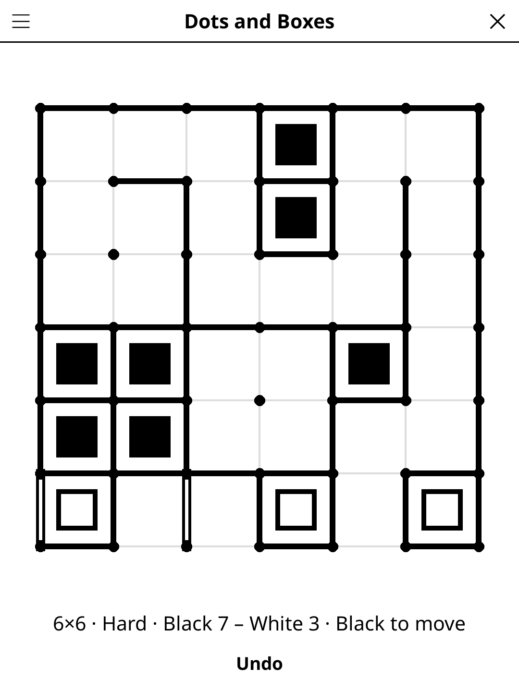

# dotsandboxes.koplugin

A Dots and Boxes (Pipopipette) plugin for [KOReader](https://github.com/koreader/koreader).

## Screenshot

## Rules

Two players take turns drawing a line between two neighbouring dots. Drawing
the fourth side of a box claims it, and the same player must draw again. When
every box is claimed, the player with more boxes wins.

## Features

- **Board sizes** — 3×3, 4×4, 5×5 or 6×6 boxes
- **Computer opponent** — three levels, or **two players** on one device
  (hotseat); play Black (first) or White against the computer
- **Tap-friendly lines** — each box is split by its diagonals into four
  triangles, one per side, so a tap anywhere near a line draws it; only taps
  right on a dot, where two lines are equally close, are ignored
- **Last turn shown** — the lines drawn during the last turn (a turn that takes
  boxes draws several) are hollow, so the computer's whole reply is visible
  after one screen refresh
- **Undo** — against the computer, takes back your last line and its reply
- **Auto-save** — the game in progress is restored on next launch

## Computer opponent

| Level | Plays |
|---|---|
| Easy | Takes any box on offer; otherwise a random line, which avoids giving a third side only half the time |
| Medium | Takes any box on offer; never gives a third side while a safe line remains; then sacrifices the chain that gives the fewest boxes |
| Hard | Medium while the board is wide open; then an exact alpha-beta search (with a transposition table) once at most 12 safe lines remain, and through the whole endgame. It knows the double-cross (declining the last two boxes of a chain, or four of a loop, to keep control) and the hard-hearted handout (opening a 2-chain in its middle) |

Measured on a desktop under LuaJIT, 100 games per match, 4 random opening
lines per game, seats alternated (wins-losses-draws):

| Match | 3×3 | 4×4 | 5×5 | 6×6 |
|---|---|---|---|---|
| hard vs medium | 93-7-0 | 90-4-6 | 100-0-0 | 97-2-1 |
| hard vs easy | 96-4-0 | 99-0-1 | 100-0-0 | 100-0-0 |
| medium vs easy | 85-15-0 | 82-10-8 | 98-2-0 | 97-2-1 |
| easy vs random | 100-0-0 | 100-0-0 | 100-0-0 | 100-0-0 |

On 6×6, hard's slowest single move took 0.25 s and its slowest whole turn
(every line it draws before handing over, here a long run of captures against
a random player) 0.46 s; a 1 GHz e-reader is roughly 5-10× slower. The search
gives up past a node budget and falls back to medium's move, so a move can
never run away.

## Controls

| Action | How |
|--------|-----|
| Draw a line | Tap near it |
| Undo | Tap **Undo** |
| New game, size, difficulty, players | Title-bar menu |

## Installation

1. Download `dotsandboxes.koplugin.zip` from the [latest release](../../releases/latest).
2. Extract into the `plugins/` folder of your KOReader data directory.
3. Restart KOReader.
4. Open the menu → **Tools** → **Dots and Boxes**.

## License

GPL-3.0 — see [LICENSE](LICENSE).
